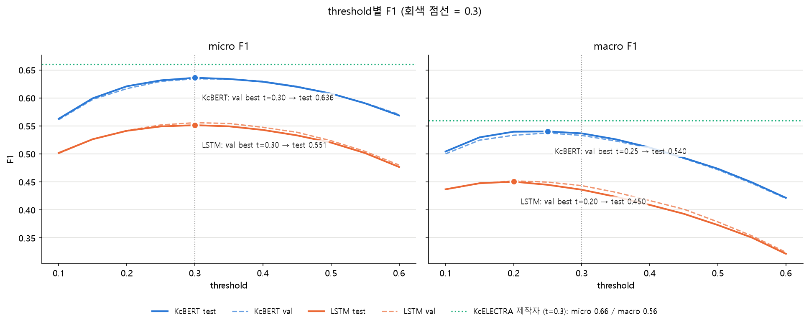
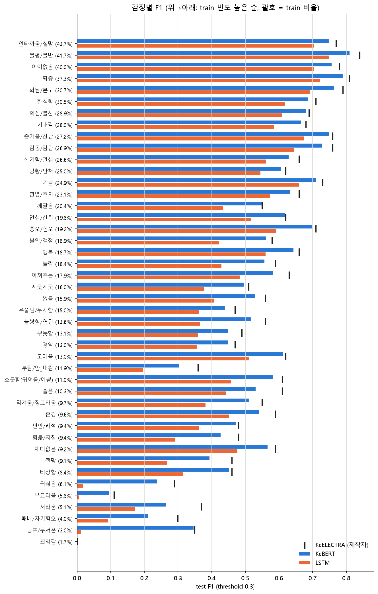
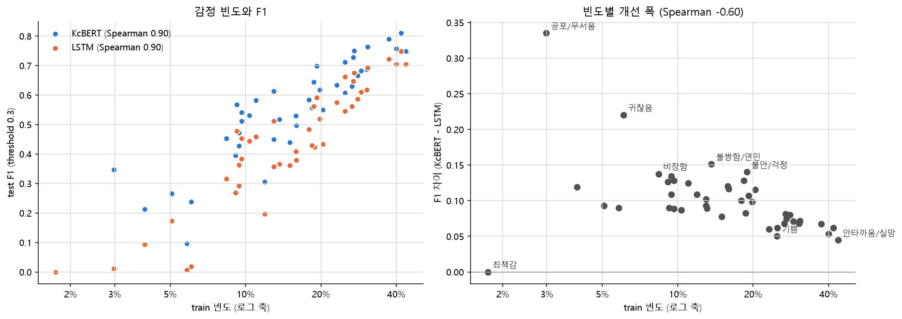

# KOTE 한국어 댓글 감정 분류: LSTM vs KcBERT

[KOTE](https://github.com/searle-j/KOTE) 데이터(댓글 5만 개, 감정 44개 다중 라벨)로 두 모델을 학습하고 비교한 프로젝트입니다.
- LSTM: MeCab 형태소와 직접 만든 vocab으로 처음부터 학습
- KcBERT(`beomi/kcbert-base`): 사전학습된 모델을 fine-tuning
- 두 모델의 결과를 KOTE 제작자의 KcELECTRA 결과와 같은 조건에서 비교

### 파일 구성
| 파일 | 내용 |
|---|---|
| `01_lstm_from_scratch.ipynb` / `.md` | LSTM 학습, 평가, 하이퍼파라미터 실험과 정리 |
| `02_kcbert_finetuning.ipynb` | KcBERT fine-tuning과 평가 |
| `03_compare_results.ipynb` | 두 모델 비교 분석 (전체 성능, threshold, 감정별 F1, 오류 사례) |
| `scripts/export_lstm_probs.py` | 01 노트북의 학습 셀을 다시 실행해 LSTM 예측 확률을 저장 |
| `results/` | 그래프, 두 모델의 val/test 예측 확률(`.npy`), 수치(`compare_metrics.json`) |

- 데이터(`data/`)와 학습된 모델(`model/`)은 용량 때문에 올리지 않았습니다. 데이터는 01 노트북 앞부분에서 KOTE 저장소로부터 내려받습니다.
- `results/`의 예측 확률만 있으면, 재학습하지 않고 `03_compare_results.ipynb`를 실행할 수 있습니다. 다만 KcBERT 파라미터 수를 계산하는 셀은 `model/` 파일이 필요합니다.

## 결과 비교: LSTM vs KcBERT vs KcELECTRA

> 분석 노트북: `03_compare_results.ipynb` / 그래프: `results/*.png` / 숫자: `results/compare_metrics.json`

### 비교 조건
- 세 모델 모두 KOTE 제공 test.tsv(5,000개), 44차원 multi-hot 정답, threshold 0.3, sklearn F1(macro = 44개 감정 단순 평균, zero_division=0)
- 조기종료와 threshold 선택은 모두 val로만 함 (test는 결과 확인에만 사용)
- KcELECTRA 값은 제작자 저장소 `codes/KOTE_pytorch_lightning.ipynb` 출력 (소수점 둘째 자리). 감정별 support가 이 프로젝트의 test와 일치함

### 전체 성능 (test)

| 모델 | threshold | micro F1 | macro F1 | 감정 평균 P | 감정 평균 R | 파라미터 | 학습 시간 |
|---|---|---|---|---|---|---|---|
| LSTM (처음부터 학습) | 0.30 | 0.551 | 0.436 | 0.411 | 0.486 | 2.54M | 1.5분 |
| LSTM | 0.20 (val로 선택) | 0.541 | 0.451 | 0.374 | 0.587 | | |
| KcBERT (fine-tuning) | 0.30 | **0.636** | **0.537** | 0.524 | 0.573 | 108.95M | 53.0분 |
| KcBERT | 0.25 (val로 선택) | 0.632 | 0.540 | 0.491 | 0.618 | | |
| KcELECTRA (제작자) | 0.30 | 0.66 | 0.56 | 0.54 | 0.61 | 약 123M | 4~5시간* |

\* 제작자 코드 주석에 적힌 값. 다른 GPU와 max_length 512 조건이라 직접 비교할 수 없음. LSTM과 KcBERT는 같은 PC에서 잰 값임.

- 0.1~0.6 모든 threshold에서 KcBERT > LSTM. val 곡선과 test 곡선이 거의 겹침
- threshold 선택으로 바뀌는 폭(+0.004~0.014)은 모델 간 차이(macro +0.09~0.10)보다 훨씬 작음

### 감정별 성능

| train 빈도 | 감정 수 | LSTM | KcBERT | KcELECTRA |
|---|---|---|---|---|
| 5% 미만 | 3 | 0.035 | 0.186 | 0.217 |
| 5~10% | 10 | 0.275 | 0.397 | 0.438 |
| 10~20% | 16 | 0.428 | 0.536 | 0.566 |
| 20% 이상 | 15 | 0.632 | 0.701 | 0.721 |

- 44개 감정 모두 KcBERT ≥ LSTM. 죄책감은 세 모델 모두 0
- 개선 폭은 드문 감정일수록 큼 (빈도와 개선 폭의 Spearman -0.60)
    - 가장 크게 오른 감정: 공포/무서움 +0.335, 귀찮음 +0.220, 불쌍함/연민 +0.152
    - 가장 적게 오른 감정: 안타까움/실망 +0.045, 기쁨 +0.050, 어이없음 +0.053
- 두 모델 모두 빈도와 F1의 관계가 강함 (Spearman 0.90) → 사전학습을 해도 희귀 감정 문제는 남아 있음

### 오류 분석 요약

| 구간 | 댓글 수 | LSTM micro F1 | KcBERT micro F1 | 차이 |
|---|---|---|---|---|
| 전체 | 5,000 | 0.551 | 0.636 | 0.085 |
| 부정어(안/못/않/없) 있음 | 1,433 | 0.571 | 0.649 | 0.078 |
| 20자 이하 | 418 | 0.515 | 0.580 | 0.065 |
| 201자 이상 | 107 | 0.681 | 0.723 | 0.042 |
| LSTM `<UNK>` 10% 초과 | 683 | 0.498 | 0.592 | 0.094 |
| KcBERT `[UNK]` 있음 (`ㅠㅠ`, `ㅡㅡ` 등) | 558 | 0.539 | 0.604 | 0.065 |

- 극성(긍정/부정)을 반대로 예측한 댓글: LSTM 15.2% → KcBERT 9.4%
- 부정어 댓글에서 KcBERT의 우위가 더 크지는 않음 (길이를 맞춰 비교해도 일정하지 않음)
- LSTM `<UNK>`가 많은 댓글은 두 모델 모두 어려움 → vocab 밖 단어로 설명되는 차이는 작음
- KcBERT vocab에 모음 자모가 없어 `ㅠㅠ`, `ㅜㅜ`, `ㅡㅡ`가 [UNK]가 되며, 이런 댓글에서 우위가 줄어듦

### KcBERT vs KcELECTRA (약 0.02 차이)를 해석할 때 주의할 점
사전학습 방식(MLM vs RTD) 외에도 다른 점이 많아서, 차이를 사전학습 방식만의 효과로 볼 수 없음.
- vocab 30,000 vs 50,135
- max_length 128 vs 512
- 학습 데이터 증강: 없음 vs 토큰 10% mask/switch
- 학습: 5 epoch (마지막 epoch까지 val 상승 중) vs 최대 15 epoch
- 실행: 각각 한 번씩
- 제작자 수치는 소수점 둘째 자리까지만 공개됨

### 개선 방향
- **감정별 threshold** (val로 선택, 재학습 없음): KcBERT test macro F1 0.540 → 0.553 (micro는 0.632 → 0.622)
- **희귀 감정 가중치**: 빈도 하위 6개 감정의 recall은 0.00~0.26. 정답 댓글에서도 평균 확률이 0.07~0.19에 그침
- **epoch 늘리기**: 5 epoch째에도 val macro F1이 오르는 중이었음
- **자모 감정 표현 처리**: `ㅠㅠ`, `ㅜㅜ`, `ㅡㅡ`를 vocab에 추가하거나 단어로 치환
- max_length 늘리기는 효과가 작을 것으로 예상: test에서 128토큰을 넘는 댓글이 15개뿐
